# agibot-g2-humanoid-packoff-cell

<p align="center">
  <a href="https://bkrakshith.github.io/agibot-g2-humanoid-packoff-cell/static/videos/01_packing_overview.mp4">
    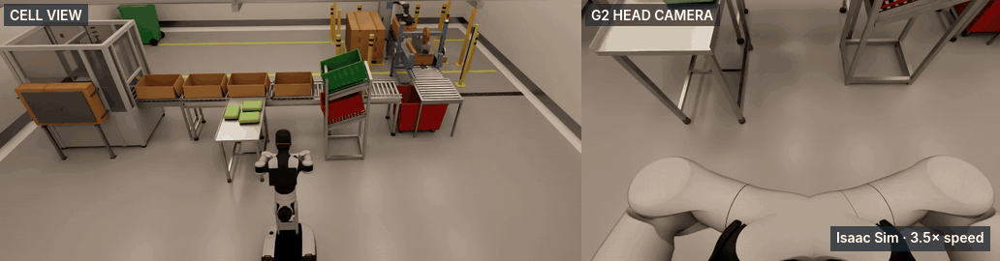
  </a>
</p>
<p align="center"><sub>
<b>One packing cycle of the AgiBot G2 in the U cell.</b> Left: the cell camera. Right: the G2 head camera.
Isaac Sim 6.0.1 through Genie Sim, 3.5× speed.<br>
This take is older than the object pose relay. Thus the bag stays on the table on camera.
In the <a href="#pilot-dataset-and-first-training-run">pilot dataset</a>, the bag moves into the carton.<br>
<a href="https://bkrakshith.github.io/agibot-g2-humanoid-packoff-cell/static/videos/01_packing_overview.mp4">Full take (MP4, 67.8 s)</a> ·
<a href="https://bkrakshith.github.io/agibot-g2-humanoid-packoff-cell/static/videos/02_packing_head.mp4">Head camera (MP4)</a> ·
<a href="https://bkrakshith.github.io/agibot-g2-humanoid-packoff-cell/">Project page</a>
</sub></p>

<p align="center">
  
  
  
  
  
  
  
</p>

**AgiBot G2 end-of-line packing for flexible, sealed bags.** Project page:
https://bkrakshith.github.io/agibot-g2-humanoid-packoff-cell/

AgiBot G2 bagged-salad pack-off cell in Genie Sim (Isaac Sim), run headless in Docker,
teleoperated from a keyboard over SSH.

This repository is a simulated work cell for a humanoid robot at the end of a packing line. The products are
flexible, sealed bags, for example bags of salad leaves, bags of crisps and other pillow packs. The robot picks the
bags from a table and puts them into cartons on a conveyor. It puts rejected bags into totes in a sort rack.

Pack-off is a manual task in many fresh-produce and snack factories. With this cell, a team can develop the robot
tasks, collect demonstration data and train policies before a test on a real line. All results in this README come
from simulation.

> **Non-commercial use only.** The code is Apache-2.0, but the cell runs only with the AgiBot G2 model and
> GenieSimAssets scene assets, which are CC BY-NC-SA 4.0. Thus this repository, as a working cell, is strictly
> for non-commercial use. See [Licence](#licence).

**Contents:** [At a glance](#at-a-glance) · [Key results](#key-results) ·
[System architecture](#system-architecture) · [Prerequisites](#prerequisites-host-this-workstation-or-the-paperspace-machine) ·
[Build](#build) · [Stage 1](#stage-1-stock-g2-scene-keyboard-teleop) ·
[Stage 2](#stage-2-the-pack-off-cell-scene--scripted-demo) ·
[Layout v2](#layout-v2-u-cell-drive-in-and-packing-demo-mobile-g2) · [Use-case development](#use-case-development) ·
[Pilot dataset](#pilot-dataset-and-first-training-run) · [SLAM and Nav2](#use-case-slam-and-nav2-mobile-g2) ·
[Teleop keys](#teleop-keys) · [Paperspace](#paperspace) · [Status](#status-and-next-steps) · [Licence](#licence)

## At a glance

| Topic | Summary |
|---|---|
| **Robot** | AgiBot G2: wheeled base, waist, two 7-DoF arms with grippers, head RGB-D camera |
| **Simulator** | AgiBot Genie Sim 3.2 on NVIDIA Isaac Sim 6.0.1, headless in Docker |
| **Software** | ROS 2 Jazzy, MoveIt 2, Foxglove, slam_toolbox, Nav2 |
| **Cell** | U cell: pick table, conveyor, sort rack. End of line: case erector, drop gap with floor bin, right-angle transfer, case sealer, cobot palletiser |
| **Inputs** | Keyboard over SSH, SpaceMouse, scripted tasks, a simulated AgiBot GDK interface |
| **Data** | MCAP bag → HDF5 episode → LeRobot v2-style folder; ACT-style and behaviour cloning training |
| **Hosts** | A workstation (RTX 3070 measured) or a cloud GPU server (Paperspace A5000 or A6000) |
| **Stage** | Simulation. The bags are rigid placeholders. No test on a real robot is complete. |

## Key results

| 20 / 20 | 0.57 cm | 99.7 Hz |
|:---:|:---:|:---:|
| pilot episodes put the bag in the carton | final position error after a 2.0 m drive-in | physics rate during data generation |
| **0.20 m** | **1.1 MB/s** | **0.05 ms** |
| minimum distance from each arm path to the head camera | episode recording on disk (raw streams: 78 MB/s) | cost of the object pose relay for each physics step |

<sub>All values come from simulation. Sources: [docs/OPTIMISATION.md](docs/OPTIMISATION.md),
[g2cell_bringup](ros_ws/src/g2cell_bringup/README.md), [g2cell_recorder](ros_ws/src/g2cell_recorder/README.md) and
[website/copy.json](website/copy.json).</sub>

## System architecture

<p align="center">
  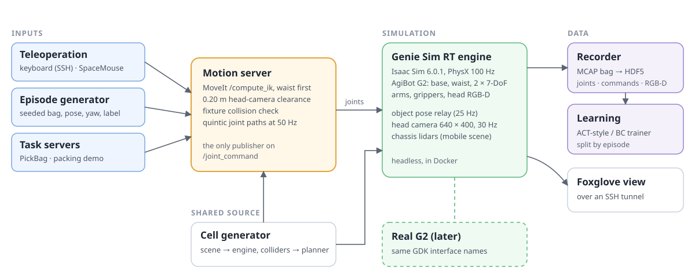
</p>

- **One joint command publisher.** Only one node at a time publishes `/joint_command`. The motion server solves the
  arm poses with MoveIt. It checks each path against the head camera and the cell fixtures. Then it sends smooth
  joint paths at 50 Hz.
- **GDK interface names.** The package `g2cell_gdk_sim` supplies the AgiBot GDK Python interface on Genie Sim.
  GDK code for the real G2 runs on the simulated cell with no change.
- **One cell file.** One Python generator makes the cell scene and the list of colliders. The planner and the
  tests use the same list.

## Prerequisites (host: this workstation or the Paperspace machine)

- NVIDIA driver ≥ 580, Docker, **nvidia-container-toolkit** (`docker info | grep -i runtimes`
  must list `nvidia`)
- Next to this folder:
  - `genie_sim/` at commit `6ca11c7`, with LFS files pulled (`git lfs pull`)
  - `geniesim_assets/`, the HuggingFace `agibot-world/GenieSimAssets` subset: package files,
    `scenes/GDK/**`, `robot/G2_omnipicker/**`
- Approximately 60 GB of free disk (base image 23 GB + Genie Sim layers + caches)

The three folders are next to each other:

```text
<work folder>/
├── agibot-g2-humanoid-packoff-cell/   this repository
├── genie_sim/                         commit 6ca11c7, LFS files pulled
└── geniesim_assets/                   GenieSimAssets subset; assets/cell/build.py writes scenes/g2cell/ here
```

## Build

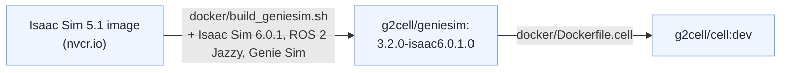

```bash
docker/build_geniesim.sh                                    # base: g2cell/geniesim:3.2.0-isaac6.0.1.0
docker build -f docker/Dockerfile.cell -t g2cell/cell:dev docker/
```

## Stage 1: stock G2 scene, keyboard teleop

```bash
docker/cell.sh up
docker/cell.sh into
# first time in a new container only: build both workspaces
cd /workspace && geniesim ros build dev
source /workspace/devel/setup.bash && cd /g2cell_ws && colcon build   # rebuild after a code change
# start everything (sim, head-camera relay, MoveIt IK, Foxglove) in tmux session "g2cell"
PROFILE=collect bash /g2cell_ws/scripts/stage1_up.sh
tmux attach -t g2cell
```

**Render profiles** (`PROFILE=` on `stage1_up.sh` / `mobile_up.sh`; measured numbers in
[docs/OPTIMISATION.md, "Sim runtime"](docs/OPTIMISATION.md)):

| `PROFILE` | renders | use for |
|---|---|---|
| `collect` | head RGB + depth 640x400 at 30 Hz, no FreeCam (3070: 30 fps, 55 % GPU) | teleop data collection, policy eval, SLAM |
| `teleop` | the same at 15 Hz (36 % GPU) | driving or debugging without recording |
| `showcase` | head + FreeCam 1280x720, upstream look (3070: 12.8 fps) | videos with `record_cams` |
| unset | the upstream render path, unchanged (head + FreeCam, 12.8 fps) | |

Head-camera images are the same in all profiles: OVRTX renders upstream's `RealTimePathTracing` token
identically to `RaytracedLighting`. Overrides: `RENDER_FPS`, `FREECAM=on|off`, `LIDAR=0|1`, `SIM_CPUS`. With a
profile the render node runs in tmux window `render` (log `/g2cell_output/render.log`). On a hybrid P/E-core CPU,
sim + render are pinned to the P-cores, which removes the engine's "loop fell behind" overruns.
Measure a running stack from the host with `python3 tools/sim_perf.py --label <name>` (writes `output/perf/<name>.json`).

In the `teleop` window run `ros2 run g2cell_teleop keyboard_teleop --ros-args -p use_sim_time:=true`.
Wait for the key help to print (approximately one minute after the sim is up). Keys typed before it
appears are dropped. `ros2 topic info /joint_command` must show exactly 1 publisher.

The scene is `ros_ws/config/scenes/scene_pnp_g2_op_cam.yaml`: upstream `scene_pnp_g2_op` with
the official G2 head-camera mount. The camera only renders correctly while
`scripts/head_cam_tf_relay.py` runs. The render node never matches the engine's TF frame
names, so without the relay the camera stays at the world origin. `stage1_up.sh` starts it.

On the laptop: `ssh -L 8765:localhost:8765 <server>`, then open a **current** Foxglove app at
`ws://localhost:8765` (foxglove_bridge 3.6 speaks only `foxglove.sdk.v1`). Add an Image panel
for `/genie_sim/head_front_camera_rgb/image_raw`.

The diagram shows how the laptop connects to the stack. Each box on the host is one tmux window.

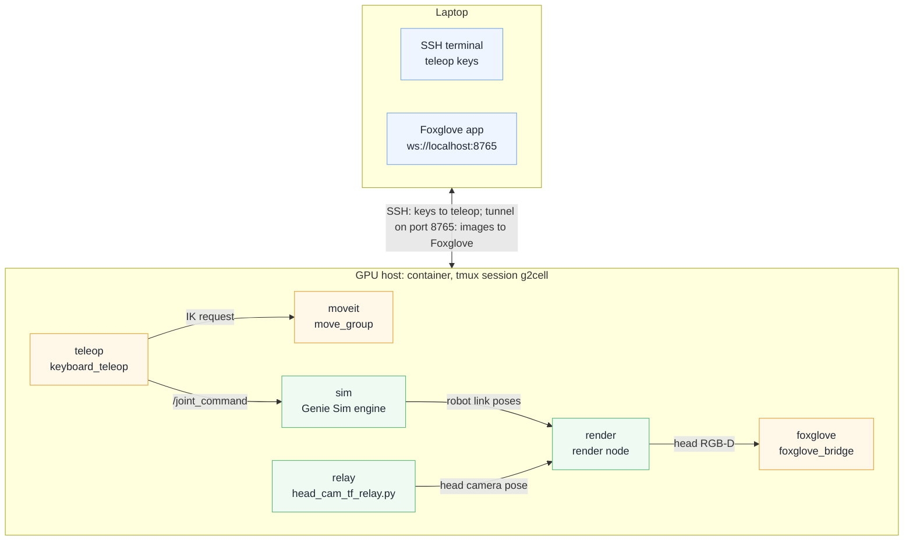

Record an episode (MCAP bag + HDF5) in another tmux window. Press Ctrl+C to stop; the bag is then
converted to HDF5:

```bash
ros2 run g2cell_recorder record_episode.sh ep001 --scene scene_pnp_g2_op_cam --seed 0
```

This writes `/g2cell_output/episodes/ep001/bag` and `.../ep001/ep001.hdf5`. The HDF5 holds:
- head RGB and head depth frames (free camera only with `--free-cam`);
- `/joint_states`, and `/joint_command` (the teleop actions);
- an `/aligned` group resampled to 30 Hz (`--rate`).

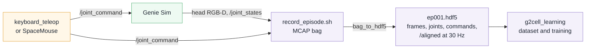

By default the recorder takes the cheap profile: head RGB as JPEG (`.../image_raw/compressed`),
depth as `compressedDepth` at 5 Hz, no free camera, MCAP chunk compression. That is ~1.1 MB/s on disk
instead of ~78 MB/s. `--full-fidelity` records the raw streams. Flags and numbers:
[ros_ws/src/g2cell_recorder/README.md](ros_ws/src/g2cell_recorder/README.md),
[docs/OPTIMISATION.md](docs/OPTIMISATION.md) "Data & training".

The schema is at the top of `g2cell_recorder/episode.py`. Until the cell image is rebuilt with
pip h5py, convert on the host instead:
`PYTHONPATH=ros_ws/src/g2cell_recorder python -m g2cell_recorder.bag_to_hdf5 output/episodes/ep001/bag -o output/episodes/ep001/ep001.hdf5 --backend mcap`
(JPEG frames need cv2 or Pillow in that python).

<p align="center">
  <a href="https://bkrakshith.github.io/agibot-g2-humanoid-packoff-cell/static/videos/03_teleop_replay.mp4">
    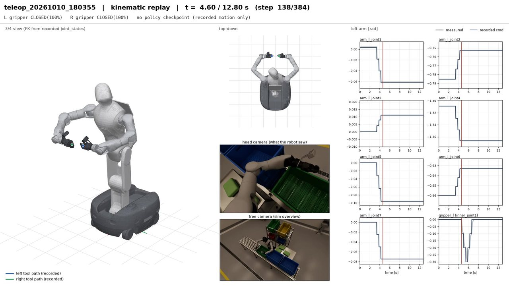
  </a>
</p>
<p align="center"><sub>
<b>A recorded teleoperation episode, drawn again from its HDF5 file.</b> Left: the robot model with the recorded
joint positions. Centre: the head camera and free camera frames. Right: the left-arm joints. Grey is measured, dark
blue is the command. They agree within 0.0012 rad. This episode is from the first scene with crates and totes.
<a href="https://bkrakshith.github.io/agibot-g2-humanoid-packoff-cell/static/videos/03_teleop_replay.mp4">Replay (MP4, 12.8 s)</a>
</sub></p>

## Stage 2: the pack-off cell scene + scripted demo

Build the scene (host; regenerates `../geniesim_assets/scenes/g2cell/` with copies of all assets), then launch:

```bash
/home/rakshith/ntu_dev/Agibot_dev/.venv-tools/bin/python assets/cell/build.py
/home/rakshith/ntu_dev/Agibot_dev/.venv-tools/bin/python -m pytest -q assets/tests
# in the container (stop a running stack first: tmux kill-session -t g2cell)
PROFILE=collect bash /g2cell_ws/scripts/stage1_up.sh /g2cell_ws/config/scenes/scene_g2cell.yaml   # showcase for videos
```

The scene is `ros_ws/config/scenes/scene_g2cell.yaml`: the G2 at the cell origin, head turned toward the
table, and `scene: scenes/g2cell/cell.usda`. The head camera still needs the relay; `stage1_up.sh` starts
it. On this launcher the engine ignores `viewer_camera`, so `stage1_up.sh` also starts
`scripts/free_cam_pose.py` (tmux window `freecam`; only when the FreeCam renders, that is `showcase` or no profile). That script aims the 1280x720 FreeCam
(`/genie_sim/free_camera_rgb`) at the YAML's pos/lookat. Layout, measured placements, deviations and
reachability are in [assets/cell/README.md](assets/cell/README.md).

**Object pose relay (bags, cartons and totes render where physics puts them).** Upstream Genie Sim sends only robot
link poses to the renderer, so moved objects stayed drawn at their spawn pose. With `OBJ_RELAY=1` (the default for
`stage1_up.sh` and `mobile_up.sh`), the engine runs as `g2cell_bringup/g2cell_engine_isaacsim.py`. That is the
upstream engine, unchanged, plus one `post_step_hook`. The hook samples the 14 top-level dynamic rigid bodies
outside `/genie` at 25 Hz. It publishes only the bodies that moved more than 0.5 mm or 0.2° on `/tf_render`, keyed
by their prim path, which is identical on the render stage. It also republishes every body every 2 s. Measured
cost (collect profile, 3070): 0.17 ms per sample, 0.05 ms per physics tick on average, approximately 0.4 % of one core.
Render fps, render time and physics step are unchanged within noise. `OBJ_RELAY=0` runs the upstream engine.
The same hook teleports or pushes objects on request (tests, episode resets):
`python3 /g2cell_ws/scripts/object_poke.py /World/Bags/Bag_01 --xyz 0.6 0.0 1.15` (or `--dxyz`, `--vel`).
Details are in [g2cell_bringup/README.md](ros_ws/src/g2cell_bringup/README.md); evidence is in `output/readiness/relay/`.

<p align="center">
  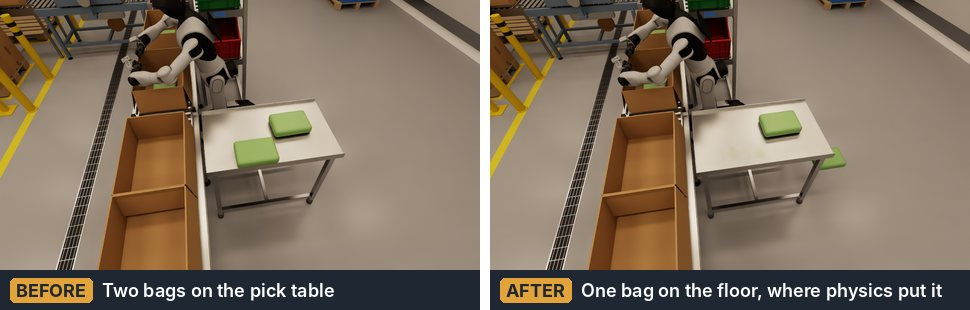
</p>
<p align="center"><sub>
<b>Object pose relay.</b> Before: two bags on the pick table. After: a test pushed one bag off the table. The camera
shows the bag on the floor, where physics put it.
</sub></p>

Scripted demo and recording. The demo must be the only `/joint_command` publisher, so quit the teleop first:

```bash
colcon build --packages-select g2cell_demo && source install/setup.bash     # in /g2cell_ws
ros2 run g2cell_demo record_cams --ros-args -p out_dir:=/g2cell_output/renders \
  -p "topics:=[/genie_sim/free_camera_rgb/image_raw/compressed,/genie_sim/head_front_camera_rgb/image_raw/compressed]" \
  -p "names:=[g2cell_overview,g2cell_head]" -p wait_for_start:=true -p "stills:=[1.0,8.0,13.0,27.0]" &
ros2 run g2cell_demo pick_place_demo --ros-args -p use_sim_time:=true -p max_joint_vel:=1.6
```

`pick_place_demo` moves both arms home, then plans every waypoint with `/compute_ik`. It rejects paths that
pass within 0.20 m of the head camera, because the G2's arm colliders are disabled. It then streams
minimum-jerk joint interpolation at 50 Hz. `record_cams` starts and stops on `/g2cell_demo/state` and pipes
frames straight into ffmpeg (no raw frames on disk). Side by side:
`ffmpeg -i g2cell_overview.mp4 -i g2cell_head.mp4 -filter_complex "[0:v]scale=960:540[a];[1:v]scale=864:540[b];[a][b]hstack" -c:v libx264 -pix_fmt yuv420p g2cell_demo.mp4`.
`ros2 run g2cell_demo reach_check` prints the IK reachability table. `scripts/physics_check.py` runs a
standalone PhysX settle or drop test of `cell.usda`; run it with the sim stopped.

## Layout v2: U cell, drive-in and packing demo (mobile G2)

The cell is now a U the G2 drives into (table left, conveyor front, sort rack right, open toward -X), with cartons on
the line, a case erector, a drop gap with a floor bin, a right-angle transfer, a case sealer and a cobot palletiser.
Numbers, reach tables and deviations: [assets/cell/README.md](assets/cell/README.md) "Layout v2".

<p align="center">
  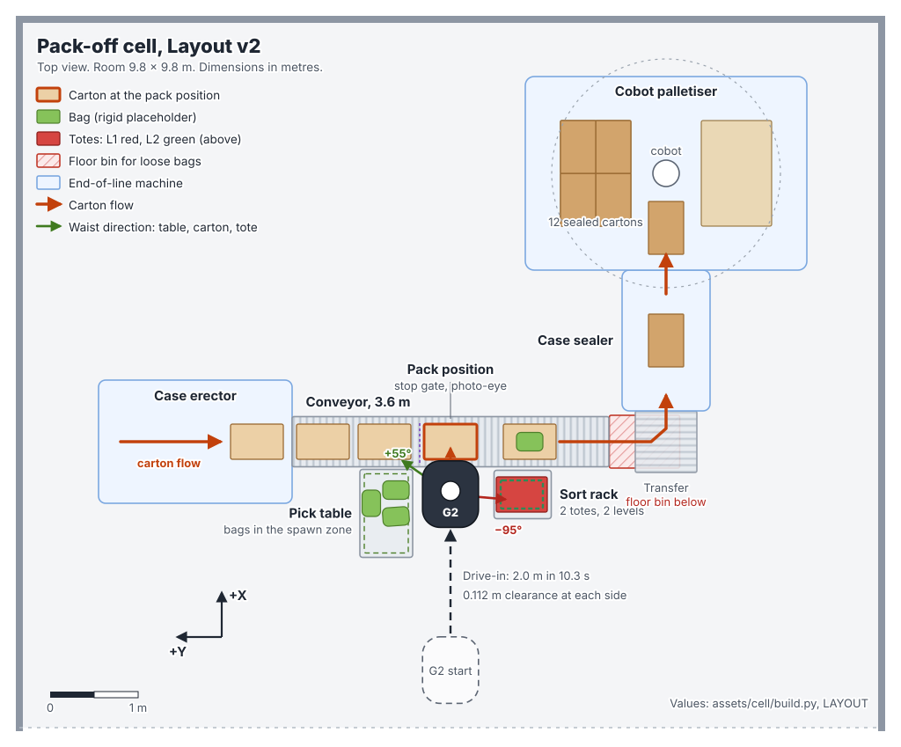
</p>

The flow of cartons and bags through the line (a dotted line is a path that is not complete):

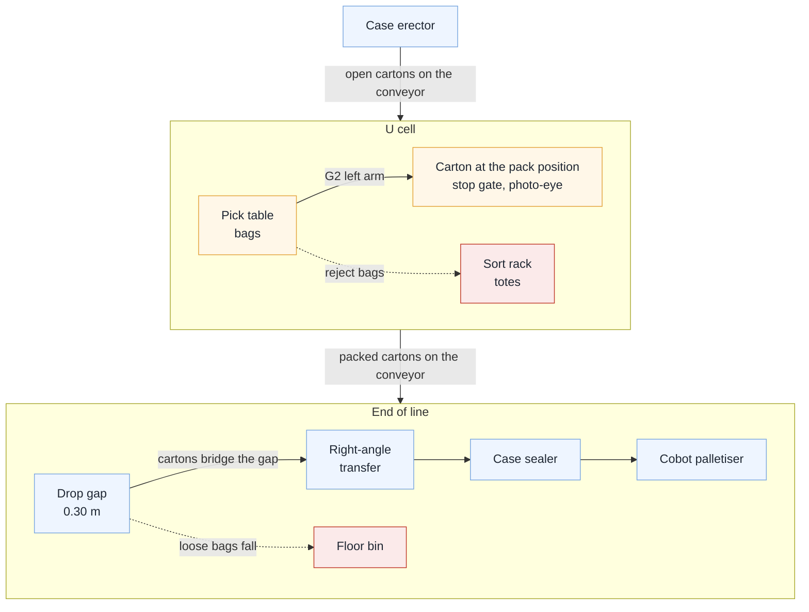

```bash
.venv-tools/bin/python assets/cell/build.py          # cell.usda + cell_colliders.json
tmux kill-session -t g2cell
PROFILE=showcase WITH_MOVEIT=1 bash /g2cell_ws/scripts/mobile_up.sh   # mobile scene + move_group (G2 starts at (-2, 0)); lidars off
ros2 run g2cell_demo drive_in                        # drive into the U only (closed loop on /odom)
ros2 run g2cell_demo record_cams --ros-args -p out_dir:=/g2cell_output/renders \
  -p "topics:=[/genie_sim/free_camera_rgb/image_raw/compressed,/genie_sim/head_front_camera_rgb/image_raw/compressed]" \
  -p "names:=[g2cell_packing,g2cell_packing_head]" -p wait_for_start:=true -p max_duration:=200.0 &
ros2 run g2cell_demo packing_demo --ros-args -p max_joint_vel:=0.8 -p tote:=L1_1
```

`packing_demo` drives in, then plans waist-first (the waist turns toward the table/rack, arm IK seeded from home) with
MoveIt `/compute_ik`, checks every joint path against the head and the cell's colliders (`g2cell_demo.env_check`),
holds the free base on `/odom` while the arms move, and is the only `/joint_command` publisher. Result JSON:
`<out_dir>/packing_demo.json`. Video: `output/renders/g2cell_packing{,_head,_side_by_side}.mp4`.

<p align="center">
  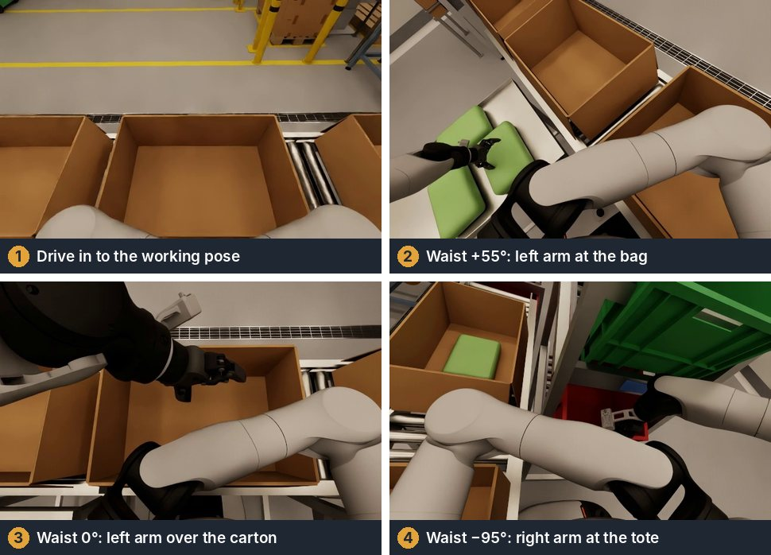
</p>
<p align="center"><sub>
<b>The packing demo, from the G2 head camera.</b> The waist turns first, then the arm moves.
</sub></p>

Every arm move goes through the same checks. Each clearance is a minimum for the full joint path:

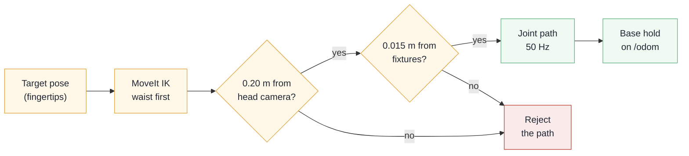

Measured in the take at the top of this README:
- The drive-in is 2.0 m in 10.3 s. The final position error is 0.57 cm and 0.00°.
- The waist turns first: +55° to the table, 0° to the carton, −95° to the rack. Then the arm moves.
- The base holds its position on odometry while the arms move. The base drift is 0.43 cm and 0.07°. Without this
  hold, a reach can push the free base by up to 23 cm.

## Use-case development

Packages (`ros_ws/src`, built with `colcon build` in `/g2cell_ws`). Each has its own README.

| Package | Role |
|---|---|
| `g2cell_interfaces` | msgs `CellStatus`, `BagInfo`, `PickPlaceResult`; srvs `SetLineState`, `SpawnBags`, `EpisodeControl`; actions `PickBag`, `MoveArm` |
| `g2cell_motion` | motion library + `motion_server` (MoveArm on `/g2cell/move_arm`): `/compute_ik` waypoints, 0.20 m head-clearance check through `/compute_fk`, quintic joint interpolation at 50 Hz on `/joint_command`, gripper helpers, named poses, single-publisher guard |
| `g2cell_tasks` | `pick_bag_server` (PickBag on `/g2cell/pick_bag`, pure tested state machine, arm choice from the reachability table, crate vs rack lane by label) and the `cell_manager` skeleton (`/g2cell/cell_status`; line and spawn services answer NOT_IMPLEMENTED until Stages 3 and 5) |
| `g2cell_bringup` | `cell.launch.py`, `teleop_record.launch.py`, `config/cell_params.yaml`, `check_stack` |
| `g2cell_teleop`, `g2cell_recorder`, `g2cell_learning` | keyboard/SpaceMouse teleop, MCAP to HDF5 episodes, dataset + policy training |
| `g2cell_demo` | Stage 2 scripted demo, reach check, camera recorder; now built on `g2cell_motion` |
| `g2cell_datagen` | scripted episode generator: seeded bag/pose/yaw/label randomisation in the reachable zone, reset (task belief or sim restart on a USD override), record → PickBag → mark → `episode.json`, resume, operator-in-the-loop mode, `datagen_batch status/finalize/card`; push with `scripts/sync_to_server.sh --push-dataset <batch>` |
| `g2cell_gdk_sim` | Python module `agibot_gdk` (3.3.8 names) with a ROS 2 backend on the sim: GDK code for the real G2 runs unchanged |
| `g2cell_slam` | mapping (slam_toolbox) and navigation (AMCL + Nav2) for the mobile G2; see [below](#use-case-slam-and-nav2-mobile-g2) |

The arrows point from a package to the packages that it depends on (`package.xml`; indirect links left out).

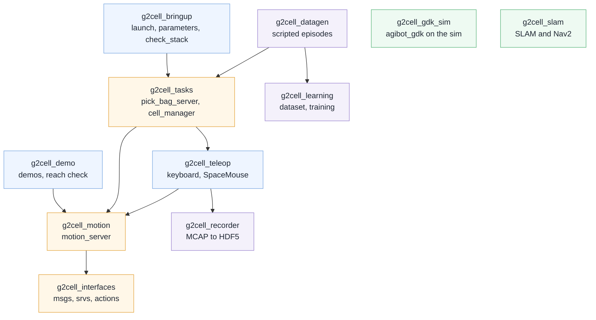

Run (sim and infra from stage1_up.sh, then the use-case nodes; quit the teleop first, because only one node may publish `/joint_command`):

```bash
bash /g2cell_ws/scripts/stage1_up.sh /g2cell_ws/config/scenes/scene_g2cell.yaml
ros2 launch g2cell_bringup cell.launch.py
ros2 run g2cell_bringup check_stack
ros2 action send_goal --feedback /g2cell/pick_bag g2cell_interfaces/action/PickBag "{bag_id: any}"
```

Writing a new use case (say, "re-arrange bags in the crate"):

1. Put the logic in a pure module in `g2cell_tasks` (or a new `g2cell_<usecase>` package) and write its pytest first.
   Inject motion and sensing as callables, like `state_machine.PickPlaceMachine` takes a runner and `Hooks`.
2. Move the arms only through `g2cell_motion.client.MotionClient` (MoveArm). Never create another `/joint_command`
   publisher. Use fingertip points in the cell frame (`frame: cell_tool`), and reuse `quat_of(result)` to keep the
   wrist orientation across a descent. Add named poses to `g2cell_motion/config/named_poses.yaml`.
3. Respect the reachability table (`g2cell_tasks/reachability.py`): the right arm cannot reach the table, and the left
   arm reaches only to Y <= ~0.85. Both arms reach the pack crate.
4. Report results as `PickPlaceResult` (or a new message in `g2cell_interfaces`). Return `unverified` rather than
   `success` when nothing observed the outcome.
5. Add the node to `cell.launch.py`, its parameters to `cell_params.yaml`, and its topics/services/actions to `check_stack.REQUIRED`.
6. Test offline before touching the sim. `ROS_DOMAIN_ID=99 python3 /g2cell_ws/scripts/offline_smoke.py` runs
   motion_server, pick_bag_server and cell_manager against a fake robot and a fake move_group. It uses an isolated domain,
   localhost-only discovery, and every robot topic/service remapped under `/offline/`. Extend it for the new node.

Host tests: `/home/rakshith/ntu_dev/Agibot_dev/.venv-tools/bin/python -m pytest -q test` in each package folder
(g2cell_learning: `../.venv-learn`, see its README).

### Pilot dataset and first training run

`g2cell_datagen` made the pilot batch `pilot_v1` in the live simulation.
- 20 of 20 episodes are successful. A scorer reads the bag position after each episode. All 20 bags are in the carton.
- One episode takes 42.4 s of wall time. Physics stays at 99.7 Hz and the head camera at 30 Hz during data generation.
- The grasp uses an attach and release at this stage, because a gripper cannot hold the rigid placeholder bag.

<p align="center">
  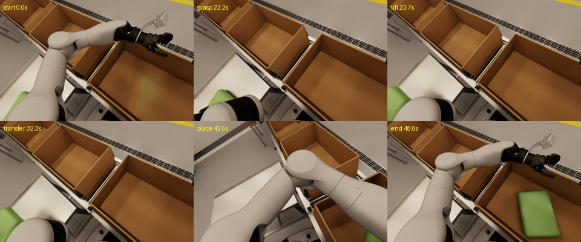
</p>
<p align="center"><sub>
<b>One pilot episode from the head camera:</b> start, grasp, lift, transfer, place and end. At the end, the bag is in
the carton.
</sub></p>

`g2cell_learning` converts the HDF5 episodes to a dataset and trains an ACT-style policy or a behaviour cloning
policy. The validation split uses complete episodes, so no frame of a validation episode is in the training data.
A first test trained a small model on the CPU for 300 steps, with 16 training episodes and 4 validation episodes.
The validation loss decreased from 0.45 to 0.075. This test shows that the pipeline works. It is not an evaluation
of a policy. Full training runs on a cloud GPU.

<p align="center">
  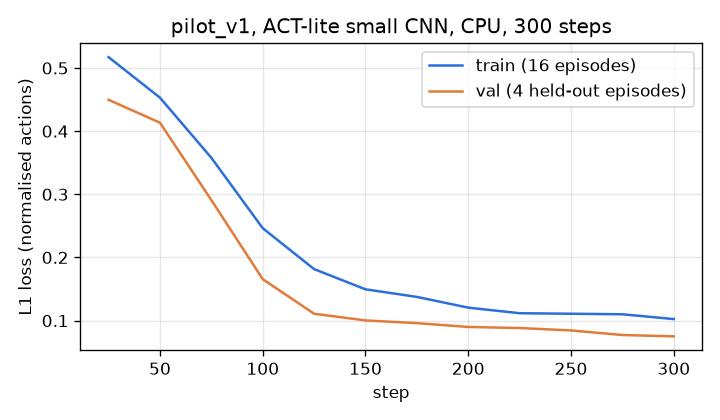
</p>
<p align="center"><sub>
<b>L1 loss on normalised actions</b>, pilot dataset, CPU, 300 steps.
</sub></p>

## Use case: SLAM and Nav2 (mobile G2)

The mobile scene `ros_ws/config/scenes/scene_g2cell_mobile.yaml` uses the same `cell.usda` with a free
G2 base and two chassis lidars. Package `ros_ws/src/g2cell_slam` maps the room with slam_toolbox and
navigates with AMCL + Nav2. Full details: [ros_ws/src/g2cell_slam/README.md](ros_ws/src/g2cell_slam/README.md).

<p align="center">
  <a href="https://bkrakshith.github.io/agibot-g2-humanoid-packoff-cell/static/videos/04_slam_nav.mp4">
    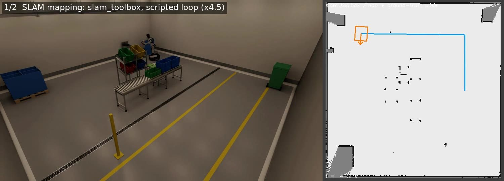
  </a>
</p>
<p align="center"><sub>
<b>Mapping and navigation.</b> Left: the mobile G2 drives a scripted loop. Right: slam_toolbox makes the map from the
two chassis lidars. Then Nav2 drives the robot to a goal on the saved map. This run used the first cell layout.
<a href="https://bkrakshith.github.io/agibot-g2-humanoid-packoff-cell/static/videos/04_slam_nav.mp4">Video (MP4, 37.7 s)</a>
</sub></p>

```bash
tmux kill-session -t g2cell                       # one stack at a time
PROFILE=collect bash /g2cell_ws/scripts/mobile_up.sh   # lidar prims + lidars (10 Hz) + chassis servo, no MoveIt
ros2 launch g2cell_slam mapping.launch.py drive:=true      # scripted loop; then map_saver_cli
ros2 launch g2cell_slam navigation.launch.py               # after rebuilding with the saved map
ros2 run g2cell_slam nav_goal --ros-args -p x:=1.65 -p y:=-0.8 -p yaw_deg:=180.0
```

How the mobile scene is wired:
- The base is commanded on `/cmd_twist`: `servo_node` (GeneralServo) turns it into `/cmd_4ws`.
  `cmd_vel_bridge` maps Nav2's `/cmd_vel` to `/cmd_twist`.
- `/odom` and the `odom -> base_footprint -> base_link` TF are ground truth from the engine.
- Use `use_sim_time:=false`: the engine stamps topics with wall time.

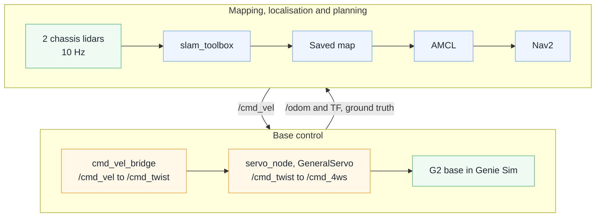

**The saved map is STALE since Layout v2** (U cell + end-of-line machines; the old start (3.4, 0) is now next to the
palletiser): remap before running Nav2. Results (pre-v2): map in `ros_ws/src/g2cell_slam/maps/factory_room.{pgm,yaml}`, preview in
`output/slam/factory_room_preview.png`. Nav2 goals succeeded (errors 0.10 m and 0.084 m;
`output/slam/nav_result_*.json`). Video: `output/renders/g2_slam_nav.mp4` (37.7 s).

`stage1_up.sh` takes optional overrides through `PROFILE` (and `RENDER_FPS`, `FREECAM`, `LIDAR`, `SIM_CPUS`), `LAUNCHER`,
`RELAY_ARGS`, `SIM_ARGS` and `NO_MOVEIT=1`. `mobile_up.sh` uses them; the cell scene is unchanged. With a `PROFILE`,
`mobile_up.sh` renders the lidars for the SLAM stack only (`LIDAR=1`; `WITH_MOVEIT=1` defaults to `LIDAR=0`). Without a
profile the lidars render at the render rate, 3.6 Hz per sensor here.

## Teleop keys

| Keys | Function |
|---|---|
| `1` / `2` | Select the left / right arm |
| `w` `s` · `a` `d` · `q` `e` | Move the tool ±X · ±Y · ±Z in the base frame |
| `i` `k` · `j` `l` · `u` `o` | Pitch ± · roll ± · yaw ± |
| `g` / `h` | Close / open the gripper |
| `[` / `]` | Halve / double the step (1–50 mm) |
| `,` / `.` | Turn the waist 5° left / right |
| `t` | Auto-face: turn the waist toward the target |
| `0` | Move both arms (and the waist) to home |
| `r` | Start / stop the recording of an episode |
| `n` / `f` | Mark the episode as success / failure |
| `p` | Pause / resume |
| `x` | Quit |

When IK has no solution, the target stays where it was. SpaceMouse (`device:=spacemouse`): button 0 toggles the
gripper, button 1 switches the arm. Setup, recording details and remote SpaceMouse use:
[ros_ws/src/g2cell_teleop/README.md](ros_ws/src/g2cell_teleop/README.md).

## Paperspace

Use an RTX-class GPU machine with 24 GB+ VRAM (A5000/A6000; not A100, which has no RT cores), ~200 GB disk,
Ubuntu 22.04. Images are built on a cheap CPU machine and pulled on the GPU box, so billed GPU time goes to
the sim, not to a > 1 h build:

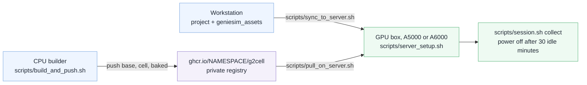

```bash
NAMESPACE=<user> scripts/build_and_push.sh   # CPU builder: base + cell + baked -> private ghcr.io/<user>/g2cell
scripts/sync_to_server.sh                    # workstation -> paperspace:~/g2 (project + geniesim_assets)
scripts/server_setup.sh                      # GPU box: disk, Docker (overlay2), driver 580 (reboot, rerun), toolkit, genie_sim
NAMESPACE=<user> scripts/pull_on_server.sh   # GPU box: pull + tag g2cell/cell:dev
sudo scripts/idle_shutdown.sh install        # power off after 30 idle minutes
scripts/session.sh collect                   # up | collect | showcase | status | down [--poweroff]
```

Keep `CACHE_ROOT` (default `~/docker/isaac-sim`, mounted by `docker/cell.sh`) on the persistent disk. It holds
the driver shader cache (~150 s per cold first frame) and the Kit cache (~75 s per container start). After the
first session, run `python3 tools/sim_perf.py --label a6000_collect` once to check that physics holds 100 Hz on
the server's vCPUs ([docs/OPTIMISATION.md "Sim runtime"](docs/OPTIMISATION.md)).

All of these scripts are safe to run again. Full flow, hour-by-hour plan and cost controls:
[docs/OPTIMISATION.md "Build & deploy"](docs/OPTIMISATION.md#build--deploy); machine choice, SSH/Foxglove
tunnelling and the build-on-the-GPU-box fallback (`BAKED=1 docker/build_all.sh`): [docs/PAPERSPACE.md](docs/PAPERSPACE.md).

## Status and next steps

| Status | Item |
|:---:|---|
| ✅ Done | Genie Sim and Isaac Sim 6.0.1 headless in Docker, on a workstation and on a cloud GPU server |
| ✅ Done | U cell with conveyor, cartons, sort rack and end-of-line machines; drive-in and packing demo |
| ✅ Done | Object pose relay: moved objects show at their physics positions on camera |
| ✅ Done | Keyboard and SpaceMouse teleoperation, episode recorder, scripted episode generator |
| ✅ Done | Pilot dataset of 20 episodes, 20 successful; training pipeline tested on the CPU |
| ✅ Done | Simulated AgiBot GDK interface (`g2cell_gdk_sim`) |
| 🟡 Partial | Reach: 41 % of the table spawn area and 1 of 2 rack totes are reachable. Reject bags to the tote need a base turn or a hand-over between arms. |
| 🟡 Partial | Mapping and navigation work on the first layout. The map must be made again for the U cell. |
| ⬜ Next | Moving conveyor with a stop gate, a photo-eye and indexing |
| ⬜ Next | Deformable bags with three variants, tuned on a test bench |
| ⬜ Next | A larger dataset and policy training on a cloud GPU |
| ⬜ Next | Photorealism and domain randomisation, then tests on a real G2 |

All tests used simulation only. No test on a real robot is complete. The software is not for the control of a real
robot near people or on a food production line. Such use needs a separate safety analysis, tests and approvals by
the user.

## Licence

The code in this repository is licensed under the Apache License, Version 2.0 (see [LICENSE](LICENSE)).
Copies of this work, and works that are based on it, must keep the [NOTICE](NOTICE) file and show this credit:
"Based on agibot-g2-humanoid-packoff-cell by Bkrakshith (https://github.com/Bkrakshith/agibot-g2-humanoid-packoff-cell)".

**Non-commercial use only.** The cell needs the AgiBot G2 model and the GenieSimAssets scene assets (AgiBot World
community licence, CC BY-NC-SA 4.0). This repository does not contain them, and they do not permit commercial use.
Thus this repository, as a working cell, is strictly for non-commercial use. Genie Sim (the base image) is MPL 2.0,
and the `agibot-gdk-training` submodule is Apache 2.0.

## Acknowledgements

- Simulator: [AgiBot Genie Sim](https://github.com/AgibotTech/genie_sim) (MPL 2.0) on
  [NVIDIA Isaac Sim](https://developer.nvidia.com/isaac/sim).
- Robot model and scene assets: the AgiBot G2 model from Genie Sim, and GenieSimAssets (AgiBot World community
  licence, CC BY-NC-SA 4.0, non-commercial use).
- GDK reference: the AgiBot Genie 02 GDK manual, a community GDK API reference (MIT) and
  [agibot-gdk-training](https://github.com/SailnMobula/agibot-gdk-training) (Apache 2.0).
- Motion planning: MoveIt 2. Middleware: ROS 2 Jazzy. Viewer: Foxglove. Navigation: slam_toolbox and Nav2.
- Policy design: in the style of ACT (Action Chunking with Transformers) and the LeRobot dataset format.

The project is not affiliated with AgiBot or NVIDIA. The names of products and companies in this README identify the
software that the project uses. They do not show an endorsement.

## Citation

```bibtex
@software{bangalorekumaraswamy2026packoffcell,
  author  = {Bangalore Kumaraswamy, Rakshith},
  title   = {agibot-g2-humanoid-packoff-cell: AgiBot G2 end-of-line packing for flexible, sealed bags},
  year    = {2026},
  url     = {https://github.com/Bkrakshith/agibot-g2-humanoid-packoff-cell},
  license = {Apache-2.0}
}
```
